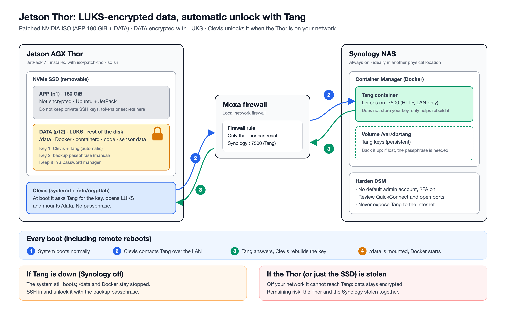

# Jetson AGX Thor: setup with an encrypted data disk

Reproducible install of a Jetson AGX Thor (JetPack 7) with:

- **APP (p1, 180 GiB):** operating system, not encrypted.
- **DATA (p12, rest of the NVMe):** LUKS2-encrypted, mounted at `/data`. Holds Docker,
  containerd, source code, credentials and sensor data.
- **Automatic unlock with Clevis + Tang:** no passphrase at boot (remote reboots work)
  as long as the Thor can reach the Tang server (Synology) on the local network.
  If the Thor is stolen and leaves the network, `DATA` stays encrypted.
- **Backup passphrase** in a second LUKS keyslot, to unlock `DATA` manually if Tang is down.



## Why this approach

- NVIDIA's USB installer offers no encryption and no partitioning choices: it writes a
  fixed table where APP takes the whole disk.
- NVIDIA's official disk encryption (`ROOTFS_ENC=1` + `l4t_initrd_flash.sh`) unlocks with a
  key held in OP-TEE; without burning fuses it uses sample keys, it does not support Tang,
  and it requires an x86_64 host.
- A generic Ubuntu live image (26.04 arm64) does not boot on the Thor: its kernel cannot
  see the Thor's USB controllers (`unable to find a medium containing a live file system`),
  so APP cannot be shrunk after installing.
- Solution: patch the partition table inside the official ISO.

## Layout

| Path | What it is |
|---|---|
| [`iso/patch-thor-iso.sh`](iso/patch-thor-iso.sh) | Patches any Thor ISO: fixed-size APP + DATA + fix for the APP size detection |
| [`postinstall/setup-data-disk.sh`](postinstall/setup-data-disk.sh) | LUKS on DATA, Clevis/Tang, `/data`, Docker and containerd on `/data`, log limits |
| [`tang/`](tang/) | Tang server for Synology Container Manager |
| [`docs/`](docs/) | Diagram |

## Step by step

### 0. Tang on the Synology (once)

See [`tang/README.md`](tang/README.md). Check from the network:

```bash
curl http://SYNOLOGY-IP:7500/adv
```

On the Moxa firewall: allow Thor → Synology:7500.

### 1. Build the patched ISO

On any Ubuntu/Debian machine (an installed Thor works) with ~20 GB free. Download the Thor
ISO from NVIDIA's [Quick Start](https://docs.nvidia.com/jetson/agx-thor-devkit/user-guide/latest/quick_start.html).

```bash
sudo apt install -y squashfs-tools xorriso fdisk
sudo ./iso/patch-thor-iso.sh ~/Downloads/<jetson-thor>.iso ~/jetson-thor-custom.iso 180
```

The script:

1. Extracts the ISO and the installer squashfs (`casper/*.nvidia.squashfs`).
2. In `/opt/nvidia/ptable.thor.nvme.dynamic`: adds `size=` to APP (p1) and appends
   `DATA` (p12) right after it, 1 MiB aligned, taking the rest of the disk.
3. In `/ai/jetsoniso_setup.bash`: replaces `grep 'p1 ' | cut -d' ' -f5` with
   `awk '$1 ~ /p1$/ {print $4}'`. The original takes the fifth space-separated word of
   `sfdisk -l`; once a partition with wider numbers follows APP, the columns get padded
   and it returns the **start sector** instead of the size (verified: it returned
   `5591104` instead of `377489344`).
4. Runs a **dry run** on a fake disk (sparse file) and executes the same command the
   installer will use. If the size does not match, it aborts without building the ISO.
5. Repacks, updates `md5sum.txt` and builds the ISO with `xorriso`.
6. Saves copies of both patched files next to the ISO, for reference.

For a new JetPack release, run it again on the new ISO. If NVIDIA changes the format, the
script fails with a message instead of producing a broken ISO.

### 2. Install

1. Write the ISO to a USB stick: GNOME Disks → "Restore Disk Image", Balena Etcher, or
   `sudo dd if=jetson-thor-custom.iso of=/dev/sdX bs=4M status=progress oflag=sync`.
2. Boot the Thor from the USB stick → GRUB → *Jetson Thor options* →
   **Flash Jetson AGX Thor Developer Kit on NVMe**. **This erases the whole NVMe.**
3. Initial setup (user, language).
4. Check:

   ```bash
   lsblk -o NAME,SIZE,PARTLABEL,MOUNTPOINT /dev/nvme0n1
   ```

   Expected: `nvme0n1p1` APP ~180G on `/`, `nvme0n1p12` DATA with the rest, not mounted.

### 3. Encrypt DATA and move Docker

```bash
sudo apt update && sudo apt full-upgrade -y
sudo ./postinstall/setup-data-disk.sh http://SYNOLOGY-IP:7500
```

It asks you to type `YES` (it formats DATA) and for the **backup passphrase** (store it in
a password manager). It does the following:

- LUKS2 on `/dev/disk/by-partlabel/DATA`, ext4 inside, mounted at `/data`.
- `clevis luks bind` to Tang; `clevis-luks-askpass.path` for unlocking at boot.
- `/etc/crypttab` and `/etc/fstab` with `_netdev,nofail`: if Tang does not answer, the
  system still boots (SSH works).
- `/var/lib/docker` and `/var/lib/containerd` as bind mounts from `/data`. This covers
  images even when Docker uses the containerd image store.
- `RequiresMountsFor` on `docker.service` and `containerd.service`: they do not start if
  `/data` is not mounted, so they never write unencrypted data to APP.
- Docker log rotation (keeps the NVIDIA runtime in `daemon.json`) and journald capped at 2G.

Also keep in `/data`: repositories, SSH keys, tokens and `.env` files.

### 4. Tests

| Test | Expected |
|---|---|
| `sudo reboot` with Tang up | `/data` mounted, `docker info` lists containers |
| Stop the Tang container + `sudo reboot` | Boots, SSH works, `/data` empty, Docker stopped |
| Manual unlock (below) | `/data` is back, Docker starts |
| `findmnt /var/lib/docker /var/lib/containerd` | Both come from `/data` |

Manual unlock:

```bash
sudo cryptsetup open /dev/disk/by-partlabel/DATA data
sudo mount -a
sudo systemctl start containerd docker
```

## Notes and risks

- **Not yet tested end to end:** that the installer accepts the extra partition (curtin
  with `preserve: true`) and that Clevis unlocks at boot on the Thor's stack. Run the
  tests above before trusting important data to it.
- If the Thor **and** the Synology are stolen together, the protection is lost. Keep them
  in different places if possible.
- Back up `docker/tang/db` on the Synology, and keep the backup passphrase safe.
- Back up the contents of `/data` with `restic` or `borg` (encrypted) to the Synology;
  do not copy the encrypted device.
- JetPack updates on an installed Thor go through `apt`; the ISO is only needed for new
  installs.

## References

- [Jetson AGX Thor Quick Start](https://docs.nvidia.com/jetson/agx-thor-devkit/user-guide/latest/quick_start.html)
- [Jetson ISO Customization Guide (r39.2.1)](https://docs.nvidia.com/jetson/archives/r39.2.1/DeveloperGuide/SD/JetsonISOCustomization.html)
- [Disk Encryption (r39.2.1)](https://docs.nvidia.com/jetson/archives/r39.2.1/DeveloperGuide/SD/Security/DiskEncryption.html)
- [Clevis](https://github.com/latchset/clevis) · [Tang](https://github.com/latchset/tang)
